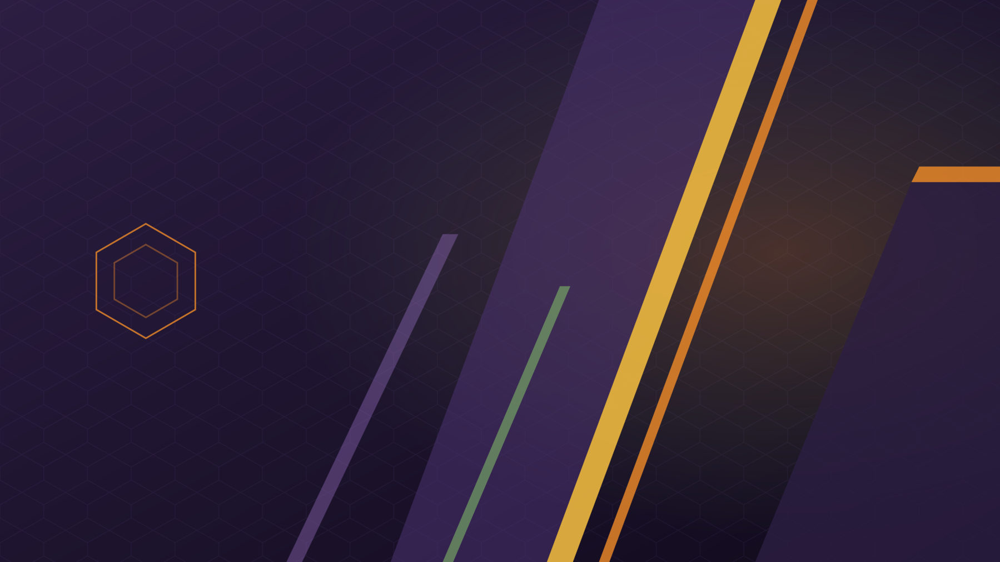

# EVA-01 — Omarchy theme



Dark theme for [Omarchy](https://omarchy.org/) inspired by the **color palette** of Evangelion Unit-01:
deep violet armor, amber accents, orange flashes and a touch of green — softened for long sessions
(low-saturation mid tones, warm-lavender text, no pure black or pure white).

The wallpaper is an original abstract composition (angular armor plates + hexagon "AT field" motif).
No artwork from the series is used, so the whole repo is free to share.

## Install

Omarchy menu → *Install > Style > Theme*, then paste:

```
https://github.com/mmilei/omarchy-eva-01-theme
```

or from a terminal:

```
omarchy theme install https://github.com/mmilei/omarchy-eva-01-theme
omarchy theme set eva-01
```

Only `colors.toml`, `icons.theme`, `keyboard.rgb` and backgrounds ship; terminal, btop, Neovim, VS Code,
Chromium, Obsidian and the shell are generated from `colors.toml`.

## Palette

| Role | Hex | | Role | Hex |
|---|---|---|---|---|
| background | `#1F1530` | | red | `#D9534A` |
| foreground | `#E0D8EA` | | orange | `#F28C28` |
| accent (amber) | `#EDB83F` | | yellow | `#F0C24E` |
| selection | `#4A3270` | | green | `#7DB868` |
| muted | `#6E5F8A` | | cyan | `#3EB5A8` |
| | | | blue | `#6B8FE0` |
| | | | magenta (EVA purple) | `#A77BD6` |

## Add your own wallpapers

Drop images in `~/.config/omarchy/backgrounds/eva-01/`.

## License

MIT (see `LICENSE`). Evangelion is a trademark of its respective owners; this project is unaffiliated.
